<div align="center">

# 🏁 GT7 Schermo e LED

**Cruscotto da 320×240 e striscia LED dietro la TV per Gran Turismo 7, F1 25 e Assetto Corsa**<br>
Due ESP32 che leggono la telemetria del gioco in Wi-Fi, senza PC.


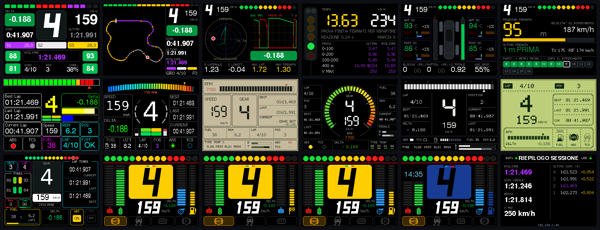

<sub>Tutte le immagini sono generate dal vero codice grafico del firmware: sono pixel per pixel quello che compare sullo schermo. I dati di gara vengono da una simulazione di guida su un circuito sintetico, elaborata dallo stesso motore di analisi del firmware.</sub>

</div>

---

## Indice

- [Come funziona](#come-funziona)
- [Hardware](#hardware)
- [Funzioni](#funzioni)
- [Analisi del giro: delta live, settori, mappa, frenate](#analisi-del-giro-delta-live-settori-mappa-frenate)
- [Circuiti salvati](#circuiti-salvati)
- [Temi del cruscotto (17)](#temi-del-cruscotto-17)
- [Notifiche](#notifiche)
- [Schermata di attesa](#schermata-di-attesa)
- [Menu e impostazioni](#menu-e-impostazioni)
- [Striscia LED dietro la TV](#striscia-led-dietro-la-tv)
- [Telemetria web della striscia](#telemetria-web-della-striscia)
- [Cruscotto sul telefono](#cruscotto-sul-telefono)
- [Comunicazione tra schermo e LED](#comunicazione-tra-schermo-e-led)
- [Compilare e caricare i firmware](#compilare-e-caricare-i-firmware)
- [Aggiornamento via Wi-Fi della striscia LED](#aggiornamento-via-wi-fi-della-striscia-led)
- [Struttura del repository](#struttura-del-repository)
- [Rigenerare gli screenshot](#rigenerare-gli-screenshot)
- [Da verificare in gioco](#da-verificare-in-gioco)
- [Prossimi passi](#prossimi-passi)
- [Crediti e licenze](#crediti-e-licenze)

---

## Come funziona

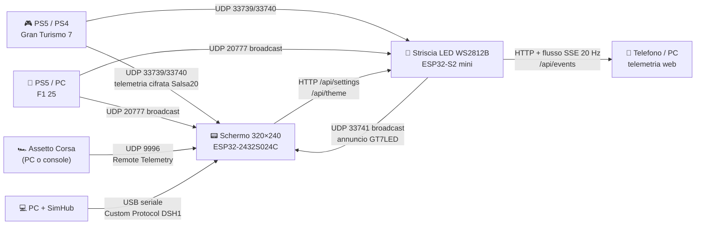

- Lo **schermo** e la **striscia LED** si collegano alla stessa rete Wi-Fi della console e ricevono la telemetria di GT7 direttamente, ognuno per conto suo.
- La striscia si annuncia in rete ogni 2 secondi. Lo schermo la trova da solo e diventa il suo **telecomando**: tema, luminosità, colore e animazione di riposo si cambiano dal touch, senza aprire la pagina web.
- **F1 25** funziona come GT7, su schermo, striscia e pagina web: i dati dell'auto diventano pacchetti in stile GT7 e passano per lo stesso codice ([come si attiva](#f1-25)).
- In alternativa lo schermo legge **Assetto Corsa** in Wi-Fi, oppure qualsiasi gioco PC tramite **SimHub** via USB.

### F1 25

Nel gioco: **Impostazioni → Telemetria**

| Voce | Valore |
| --- | --- |
| Telemetria UDP | Attiva |
| Modalità broadcast UDP | **Attiva** (così ricevono schermo e striscia insieme) |
| Porta UDP | 20777 |
| Frequenza di invio UDP | 60 Hz (se la striscia scatta, 30 Hz) |
| Formato UDP | 2025 (vanno bene anche 2024 e, con il Season Pack, 2026) |
| Telemetria dell'auto | Pubblica, se giochi online |

Se la riga gialla sulla schermata di attesa resta su *nessun dato*, il broadcast non arriva (alcuni router non lo passano dalla console al Wi-Fi): spegni la modalità broadcast e scrivi come **indirizzo IP** quello dello schermo (è nella stessa riga). Lo schermo inoltra i dati alla striscia sulla porta 20778, quindi ricevono comunque tutti e due.

Sullo schermo la connessione è **GT7 / F1 25** (la stessa di GT7: ascolta i due giochi insieme). La striscia ascolta sempre tutti e due. Il contagiri usa le luci di cambiata del gioco: dove si accende la prima e dove si accendono tutte lo impara nei primi allunghi. Sullo schermo la posizione mostrata è quella in gara; i circuiti salvati sono per scuderia. Il decodificatore ([`lib/F1Udp`](firmware/dashboard/lib/F1Udp/F1Decoder.h)) è condiviso dai due firmware e provato da [test](firmware/dashboard/tests/f1_decoder.cpp) con pacchetti costruiti byte per byte e da una gara simulata che passa per l'analisi della striscia.

> **Assetto Corsa Competizione** ed **EA Sports WRC** su PS5 non trasmettono telemetria: nessun cruscotto esterno può leggerli. Assetto Corsa (il primo) e F1 25 sì.
- La striscia ha una **pagina web di telemetria in tempo reale** (contagiri, delta, settori, mappa, forze G, tracce, gomme, giri, esportazione CSV) da aprire sul telefono o sul PC ([come](#telemetria-web-della-striscia)).
- Dai dati grezzi del gioco lo schermo (e anche la striscia, con lo stesso codice) calcola da solo **delta live, settori, mappa del circuito, forze G, tempi di accelerazione, punti di frenata e slittamento delle ruote** ([come](#analisi-del-giro-delta-live-settori-mappa-frenate)) e si ricorda dei circuiti già guidati ([come](#circuiti-salvati)).

## Hardware

| Componente | Modello | Note |
| --- | --- | --- |
| Schermo | **ESP32-2432S024C** (2.4″ ILI9341, touch capacitivo CST820) | scheda in uso, ambiente `esp32-2432s024c`; flash da 4 MB: firmware da 3 MB e 896 KB di filesystem per i circuiti salvati |
| Schermo, alternativa | ESP32-2432S028 (2.8″ ILI9341 o ST7789, touch resistivo) | ambienti `esp32` e `esp32-st7789` |
| Controller LED | **LOLIN / Wemos ESP32-S2 mini** | dati LED sul **GPIO 7** |
| LED | Striscia **WS2812B** (fino a 200 LED, 143 di default) dietro la TV su tre lati: destro, alto, sinistro | alimentazione 5 V, limite corrente regolabile |

## Funzioni

**Schermo**

- 🚗 Telemetria **GT7 diretta in Wi-Fi**, con rilevamento automatico della PS5 (nessun IP da inserire)
- 🏎️ Telemetria **Assetto Corsa** in Wi-Fi (PC e console): il limite dei giri viene imparato per ogni auto
- 🔌 **SimHub USB** per i giochi PC, con [un'unica formula valida per tutti i temi](firmware/dashboard/simhub/custom-protocol.txt)
- 🎨 **17 temi** selezionabili con anteprima dal touch
- ⏱️ **Delta live** metro per metro rispetto al giro migliore, in tutti i temi (oppure differenza ultimo giro - migliore, a scelta)
- 🟪 **3 settori** con i colori della F1: viola miglior tempo, verde meglio del giro migliore, giallo più lento
- 🗺️ **Mappa del circuito** disegnata da sola durante il primo giro, con la posizione dell'auto e i settori colorati
- 📈 **Forze G** con scia e **tracce di gas e freno** in stile MoTeC
- 🛞 **Aderenza**: slittamento di ogni ruota, **bloccaggi** sotto frenata e **pattinamenti** sotto gas contati giro per giro, temperature delle gomme, carico delle sospensioni
- 🛑 **Punti di frenata**: conto alla rovescia in metri verso il punto dove il giro migliore ha frenato, e di quanti metri prima o dopo hai frenato nelle curve già fatte
- 💾 **Circuiti salvati**: mappa, giro di riferimento, settori e punti di frenata restano in flash, per auto e per circuito
- 🚦 **Cronometro accelerazioni** automatico: 0-100, 0-200, 100-200 km/h e 400 m con velocità d'uscita, con l'albero di Natale da drag race e il tempo di reazione
- 🔔 **Notifiche a schermo**: GIRO MIGLIORE, ULTIMO GIRO, RISERVA
- 📋 **Riepilogo della sessione** sulla schermata di attesa: migliore, giro ideale, media, velocità massima, ultimi giri
- ⛽ Consumo e autonomia stimata, rilevamento automatico delle auto elettriche
- 🚨 Spie ABS, TCS, ASM, freno a mano, box; marcia consigliata (Ferrari Gold, BMW M)
- 🕐 Orologio con ora legale automatica (tema BMW M)
- 🖼️ Tre sfondi per la schermata di attesa (Minimale, Racing, Riepilogo)
- 🚥 Controllo completo della striscia LED dal touch
- 📶 Configurazione Wi-Fi con QR code; se la rete salvata non si trova, il portale si riapre da solo
- 🌙 Spegnimento manuale e sospensione/risveglio automatici
- 🇮🇹 Interfaccia in italiano

**Striscia LED**

- 📺 **Montaggio dietro la TV** a U rovesciata: parte in basso a destra, sale, attraversa il lato alto e scende a sinistra (o il contrario), nessun LED sul lato basso; LED per lato configurabili con una **prova di montaggio**
- 🚥 **13 temi in gara**: i 6 classici invariati più **Delta**, **Pedali**, **Velocità**, **Forze G**, **Gomme**, **Ambiente** e **Solo avvisi**
- 🔔 **8 avvisi** sopra ogni tema, ognuno attivabile: limitatore, giro migliore, settori, punti di frenata, riserva, bloccaggi e pattinamenti, ultimo giro e arrivo, marcia consigliata
- ⏱️ **Analisi del giro a bordo**: delta live, settori, punti di frenata, aderenza e consumo calcolati dalla striscia stessa con lo stesso codice dello schermo, e **circuiti salvati** in flash
- 💤 **8 animazioni a gioco fermo**: spento, colore fisso, respiro, arcobaleno, onda, fuoco, aurora, luce TV; spegnimento automatico dopo N minuti senza GT7
- 📱 **Telemetria web pro** in tempo reale, anteprima dal vivo della striscia, giri ed esportazione CSV
- Impostazioni salvate in memoria, configurazione Wi-Fi con WiFiManager
- Aggiornamento del firmware via Wi-Fi dalla sua pagina web, con l'avanzamento mostrato sui LED ([come](#aggiornamento-via-wi-fi-della-striscia-led))

---

## Analisi del giro: delta live, settori, mappa, frenate

GT7 e Assetto Corsa trasmettono solo dati grezzi: posizione, velocità, contagiri, tempo del giro in corso. Tutto il resto lo calcola lo schermo, in [`src/LapAnalysis.h`](firmware/dashboard/src/LapAnalysis.h). È C++ puro, verificato da [test automatici](firmware/dashboard/tests/lap_analysis.cpp) su un circuito simulato.

| Cosa | Come viene calcolato |
| --- | --- |
| **Delta live** | Durante ogni giro lo schermo salva il tempo ogni 12,5 m di strada percorsa (GT7) o ogni 1/2048 di giro (AC, che fornisce la frazione del giro). Il delta confronta il tempo attuale con quello del giro migliore **nello stesso punto della pista**: verde se sei in anticipo, rosso se sei in ritardo. |
| **Settori** | La pista è divisa in tre parti uguali. Ogni settore diventa **viola** se è il migliore della sessione, **verde** se è più veloce dello stesso settore del giro migliore, **giallo** se è più lento. Il **giro ideale** è la somma dei tre settori migliori. |
| **Mappa** | Al primo passaggio sul traguardo lo schermo comincia a registrare le coordinate dell'auto. Il tracciato compare mentre guidi e si chiude al passaggio successivo. Le coordinate X e Z dei giochi danno una mappa con lo stesso orientamento di quella del gioco. |
| **Forze G** | Laterale: velocità × rapidità di sterzata della traiettoria. Longitudinale: variazione di velocità. Sul cerchio il punto si muove come la forza che senti: in alto in frenata, a sinistra in una curva a destra. |
| **Accelerazioni** | Fermati per 1 secondo: si accende l'albero di Natale (2 luci bianche, 3 gialle ogni 0,5 s, poi verde). Il tempo parte quando l'auto si muove e la prova finisce quando freni o rilasci. Il 100-200 viene misurato anche in movimento. |
| **Punti di frenata** | Una frenata è una pressione del pedale sopra il 25% sopra i 72 km/h che dopo 0,35 s sta ancora premendo e ha fatto perdere almeno 6 km/h: uno sfioramento o un piede appoggiato non contano. Se rilasci meno di 0,4 s resta la stessa frenata, e una nuova si apre solo 1,5 s dopo la fine della precedente. Il punto è la **posizione sulla pista** dove il pedale è sceso. Il confronto è con i punti del **giro migliore**: la distanza lungo la direzione di marcia dà i metri "prima" (+) o "dopo" (−). Si usa la posizione e non la distanza dal traguardo perché quest'ultima, sommata su un giro, cambia di decine di metri con la traiettoria. |
| **Slittamento delle ruote** | `(velocità della ruota − velocità dell'auto) / velocità dell'auto`, con la velocità della ruota presa da `wheelRPS × tyreRadius` (la stessa convenzione già usata per l'ABS). Sotto 29 km/h non si misura. **Bloccaggio**: ruota più lenta del 12% con il freno oltre il 10%. **Pattinamento**: più veloce del 10% con il gas oltre il 15%. Servono 3 pacchetti di seguito (50 ms) e gli impulsi dell'ABS contano come un solo evento. |
| **Carico delle sospensioni** | Ogni angolo è confrontato con la propria altezza a riposo (aggiornata solo in marcia tranquilla) e scalato sul movimento massimo visto con l'auto. Il verso (altezza che cala o che cresce sotto carico) si impara da sé: sotto frenate forti l'asse anteriore deve essere quello carico. |
| **Uso del grip** | Accelerazione combinata (laterale e longitudinale) rispetto al massimo visto con l'auto, con un minimo di 0,7 g; il massimo si abbassa lentamente così un urto non lo fissa per sempre. |

Per evitare dati falsati:

- Il **giro di uscita dai box** non viene contato: il suo inizio non passa dal traguardo.
- Il **primo giro di gara** parte dalla griglia, dietro al traguardo. Viene cronometrato, ma non diventa il riferimento del delta e non disegna la mappa: la mappa parte dal primo giro lanciato.
- Un **salto di posizione** (riavvio, rewind, cambio sessione) annulla il giro in corso.
- **Cambiando auto** i tempi ripartono da zero e la mappa resta. **Cambiando pista** riparte tutto: Assetto Corsa comunica il nome del circuito, per GT7 lo schermo se ne accorge quando l'auto resta a più di 200 m dal tracciato registrato.
- Dal menu **FUNZIONI** puoi azzerare mappa e tempi in ogni momento.

> Con **SimHub** il delta resta quello calcolato da SimHub. Mappa, settori, forze G, accelerazioni e punti di frenata servono i dati diretti di GT7 o Assetto Corsa; slittamento e sospensioni solo quelli di GT7 (Assetto Corsa non ne comunica).

## Circuiti salvati

GT7 non dice su che pista sei: lo schermo lo capisce dalla posizione e dalla direzione, e si ricorda di quelli già guidati.

- **Cosa si salva.** *Il circuito* (mappa e lunghezza del giro) e, per ogni auto, *il giro di riferimento* (tempi lungo il giro, tempi dei settori, punti di frenata). Il circuito viene scritto quando la mappa è completa, il riferimento a ogni giro migliore. Sono due piccoli file, 2 KB e fino a 9 KB, nella cartella `/t` del filesystem.
- **Come si ritrova.** All'inizio della sessione, mentre non ha ancora una mappa, ogni 2 secondi lo schermo controlla se l'auto si trova a meno di 30 m dal tracciato di un circuito salvato **e va nel suo stesso senso**: la stessa strada percorsa al contrario è un altro circuito, con la propria mappa. Al primo giro lanciato hai già delta, settori colorati e punti di frenata, senza aver disegnato niente.
- **Per ogni auto.** Cambiando auto i tempi ripartono, come prima; il giro di riferimento della nuova auto viene cercato tra quelli salvati.
- **Limiti.** Fino a **16 circuiti** e **48 giri di riferimento**: oltre, i più vecchi vengono sostituiti. Un file danneggiato (CRC sbagliato, scrittura interrotta) viene ignorato e il circuito si registra di nuovo.
- **Azzerare.** *FUNZIONI → azzera mappa e tempi* cancella anche i dati salvati del circuito in corso (altrimenti una mappa sbagliata tornerebbe al prossimo avvio). Il *ripristino di fabbrica* cancella tutto.
- **Assetto Corsa** salva a parte (usa la frazione del giro e non la distanza): un circuito imparato con GT7 non si carica in AC e viceversa.
- Se il filesystem non si monta, lo schermo funziona come prima senza salvare nulla. La prima volta dopo la nuova tabella delle partizioni formatta lo spazio: l'avvio dura qualche secondo in più (fino a una decina, solo quella volta).

---

## Temi del cruscotto (17)

Tutte le schermate dei temi, nello stesso momento di gara simulato:

- **In curva**: quarto giro, in anticipo sul giro migliore.
- **In frenata**: quinto giro, ABS attivo, in ritardo.
- **Al limitatore**: sesta marcia, luci che lampeggiano.

### I 6 temi con l'analisi del giro

#### FORMULA
Volante da monoposto. Shift light verdi, rossi e viola, tutti viola lampeggianti al limitatore. Delta live su un riquadro verde o rosso, marcia al centro, velocità, giro in corso e ultimo giro. Sotto, i tre settori con colori e tempi, le quattro gomme agli angoli (colore in base alla temperatura), il giro migliore, il giro, la posizione e il carburante.

| In curva | In frenata | Al limitatore |
| :-: | :-: | :-: |
| 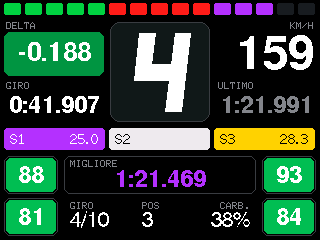 | 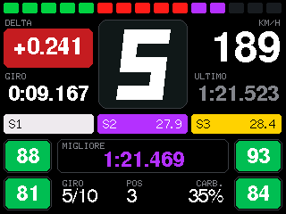 | 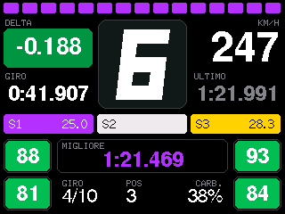 |

#### MAPPA PISTA
Prima del traguardo la mappa è vuota. Durante il primo giro lanciato il tracciato si disegna da solo e la scala si adatta man mano. Poi compaiono la posizione dell'auto (pallino rosso), la linea del traguardo e i tre settori colorati: quelli del giro in corso già completati, gli altri del giro precedente. A destra: marcia, velocità, delta, giro in corso, ultimo, migliore, settori, giro e posizione.

| Prima del traguardo | Mappa in costruzione | In curva |
| :-: | :-: | :-: |
| 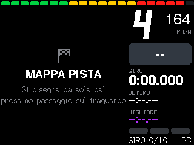 | 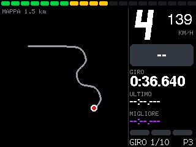 | 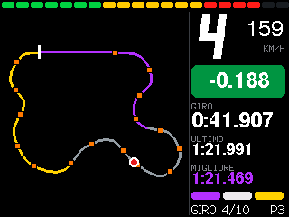 |
| **In frenata** | **Al limitatore** | |
| 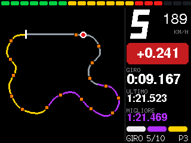 | 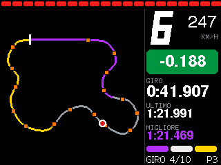 | |

#### TELEMETRIA
Cerchio delle forze G con la scia degli ultimi 3 secondi: in frenata il punto sale, in una curva a destra va a sinistra. Accanto, le tracce di gas (verde) e freno (rosso) degli ultimi 7 secondi, il delta e, in basso, G laterale, G longitudinale e i picchi della sessione.

| In curva | In frenata | Al limitatore |
| :-: | :-: | :-: |
| 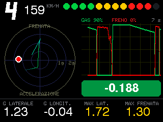 | 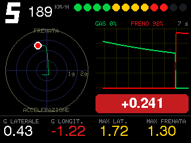 | 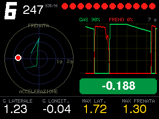 |

#### PRESTAZIONI
Cronometro automatico. Fermati 1 secondo e l'albero di Natale si accende: 2 luci bianche, poi 3 gialle ogni mezzo secondo, poi la verde. Se parti prima della verde si accende la rossa (falsa partenza). Misura 0-100, 0-200 e 100-200 km/h, i 400 m con la velocità d'uscita e la velocità massima, sia per l'ultima prova sia per la migliore della sessione (in viola).

| Partenza (luci gialle) | Prova in corso | Prova finita |
| :-: | :-: | :-: |
| 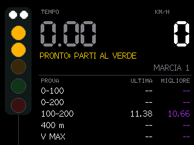 | 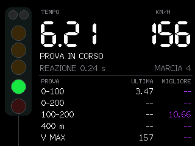 | 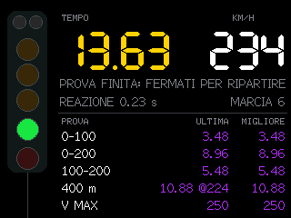 |
| **Falsa partenza** | **Al limitatore** | |
| 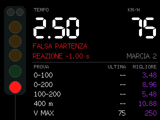 | 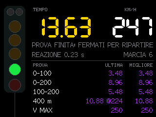 | |

#### ADERENZA
Le quattro ruote a colpo d'occhio. Ogni angolo ha la **temperatura** della gomma (colore in base al valore), lo **slittamento** in percentuale con una barra (a sinistra i bloccaggi, a destra i pattinamenti, le zone scure sono oltre le soglie) e il **carico** della sospensione. L'auto vista dall'alto accende la ruota che slitta: **rosso** per un bloccaggio, **arancione** per un pattinamento; resta accesa 0,6 s per vedere anche un episodio breve. Ai lati le barre di **freno** e **gas**. In basso: bloccaggi e pattinamenti del giro (tra parentesi quelli del giro precedente), G totale e uso del grip. Con Assetto Corsa compare "NO DATI RUOTE".

| In curva | In frenata: bloccaggio | Uscita di curva: pattinamento |
| :-: | :-: | :-: |
| 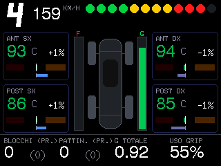 | 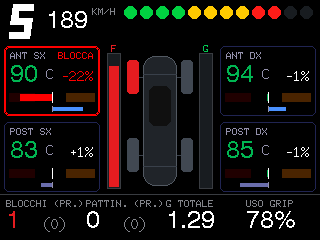 | 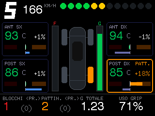 |
| **Al limitatore** | | |
| 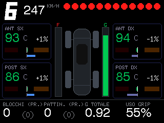 | | |

#### FRENATA
Il coaching dei punti di frenata. In alto il **conto alla rovescia in metri** verso il prossimo punto dove il giro migliore ha cominciato a frenare (ogni 5 m oltre i 100 m, ogni metro sotto), con la velocità a cui lo prendeva. La barra si riempie da 300 m in poi e passa da verde a giallo (150 m) e a rosso (50 m). Sotto, **l'ultima frenata**: di quanti metri sei stato *prima* o *dopo* (verde entro 5 m, giallo entro 15, rosso oltre) e la tua velocità d'ingresso contro quella di riferimento. In fondo un riquadro per ogni punto del giro con il suo esito (+ prima, − dopo); quello bianco è il prossimo. Serve un giro di riferimento: senza, il conto alla rovescia dice "SERVE UN GIRO DI RIFERIMENTO". Anche la **mappa pista** mostra i punti di frenata come quadratini arancioni.

| In avvicinamento | In frenata | Al limitatore |
| :-: | :-: | :-: |
| 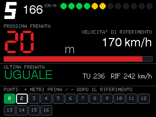 | 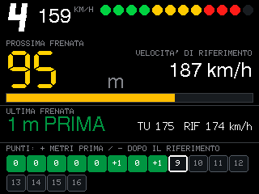 | 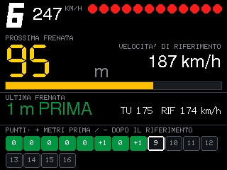 |

### Gli altri 11 temi

| # | Tema | In curva | In frenata | Al limitatore |
| :-: | --- | :-: | :-: | :-: |
| 0 | **Classic**<br><sub>Layout originale a 5 colonne, tempi grandi, delta colorato</sub> | 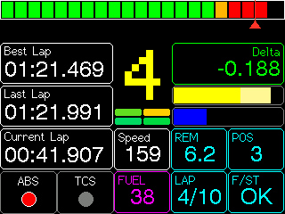 | 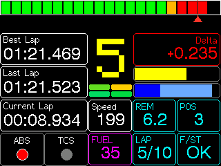 | 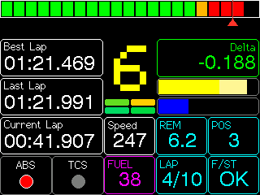 |
| 1 | **GT3**<br><sub>Tema scuro motorsport (predefinito), contagiri ad arco</sub> | 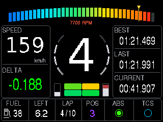 | 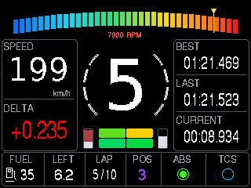 | 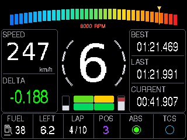 |
| 2 | **Retro**<br><sub>Strumentazione carta e inchiostro</sub> | 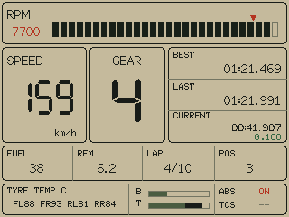 | 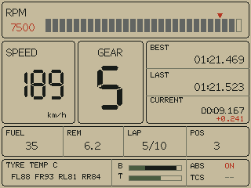 | 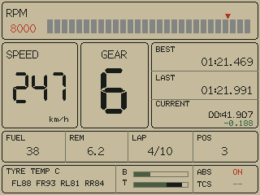 |
| 3 | **Radar**<br><sub>Contagiri circolare al centro</sub> | 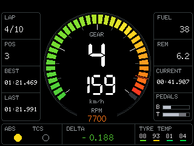 | 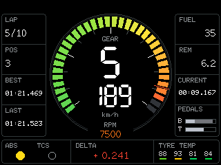 | 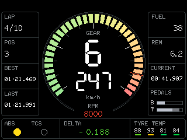 |
| 4 | **Mono**<br><sub>Digitale monocromatico</sub> | 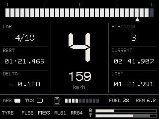 | 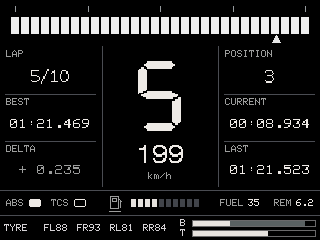 | 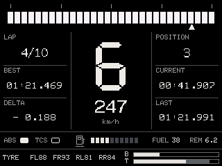 |
| 5 | **Pocket**<br><sub>LCD da console portatile a 4 toni</sub> | 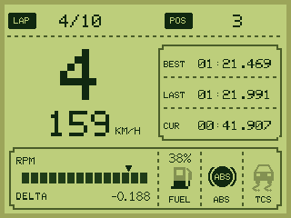 | 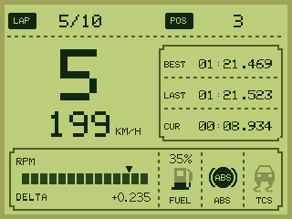 | 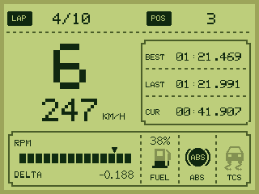 |
| 6 | **Endurance**<br><sub>Gare di durata: gomme, carburante, giri</sub> | 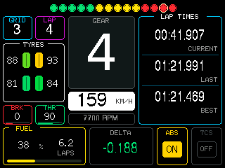 | 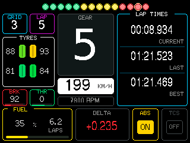 | 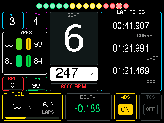 |
| 7 | **Ferrari**<br><sub>Marcia su pannello giallo, 15 LED, freno/gas, turbo e benzina</sub> | 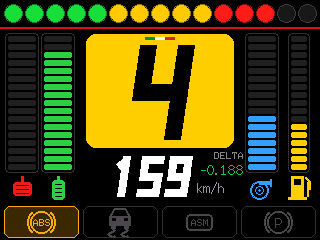 | 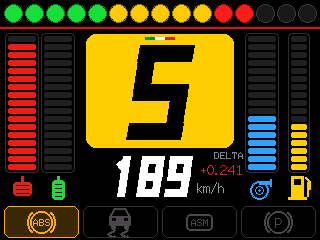 | 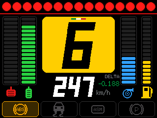 |
| 8 | **Ferrari AC**<br><sub>Per Assetto Corsa: frizione, avanzamento giro, spia PIT</sub> | 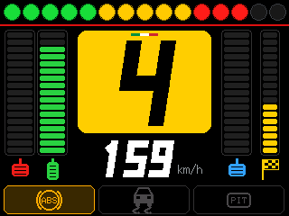 |  |  |
| 9 | **Ferrari Gold**<br><sub>Come Ferrari, con la marcia consigliata nell'angolo del pannello</sub> |  |  |  |
| 10 | **BMW M**<br><sub>Pannello blu con le strisce M, orologio, marcia consigliata</sub> |  |  |  |

<sub>Numeri dei temi come nel firmware: 11 Formula, 12 Mappa pista, 13 Telemetria, 14 Prestazioni, 15 Aderenza, 16 Frenata. I temi 7–14 sono stati creati in questo progetto; i temi 0–6 vengono da <a href="https://github.com/caa1211/esp32-gt7-dashboard">esp32-gt7-dashboard</a>.</sub>

## Notifiche

Per 3 secondi occupano lo schermo. Giri, marcia, tempo del giro e velocità restano aggiornati in alto e in basso. Si possono disattivare dal menu **FUNZIONI**.

| Giro migliore | Primo giro | Ultimo giro | Riserva |
| :-: | :-: | :-: | :-: |
|  |  |  |  |
| Nuovo record, con il miglioramento | Il primo giro cronometrato della sessione | All'inizio dell'ultimo giro di gara (GT7) | Carburante per meno di 1,5 giri o sotto l'8% |

## Schermata di attesa

Compare quando il gioco non trasmette. In alto ci sono lo stato del Wi-Fi e della striscia LED: il pallino è verde se è collegata o trovata, e toccando "LED" se ne aprono i controlli. In basso c'è l'indirizzo IP dello schermo.

| Minimale | Racing | Riepilogo |
| :-: | :-: | :-: |
|  |  |  |
| **Riepilogo senza giri** | **Wi-Fi scollegato** | |
|  |  | |

Lo sfondo **Riepilogo** mostra i tempi della sessione appena guidata: giro migliore, giro ideale (somma dei settori migliori), media, velocità massima e gli ultimi giri con il distacco dal migliore.

## Menu e impostazioni

Tocca lo schermo in qualsiasi momento per aprire il menu. Senza tocchi si chiude da solo dopo 15 secondi (60 nelle impostazioni LED).

| Impostazioni | Funzioni | Funzioni dopo l'azzeramento |
| :-: | :-: | :-: |
|  |  |  |
| **Selezione tema** | **Anteprima a tutto schermo** | **Dispositivo** |
|  |  |  |
| **Sfondo: Minimale** | **Sfondo: Racing** | **Sfondo: Riepilogo** |
|  |  |  |
| **Impostazioni LED** | **LED non trovata** | **Scelta connessione** |
|  |  |  |
| **Configurazione Wi-Fi** | **Ripristino totale** | **Calibrazione touch** |
|  |  |  |
| **Verifica calibrazione** | | |
|  | | |

**Impostazioni LED**: dallo schermo si gestiscono tutte le impostazioni della pagina web della striscia. Tema in gara, animazione a gioco fermo e avvisi si scelgono con una **demo animata**: la striscia disegnata intorno alla TV, con i LED di ogni lato come sono montati, calcolata dallo stesso codice degli effetti della striscia ([`LedEffects.h`](firmware/led-strip/src/LedEffects.h)) su una guida simulata (tre marce in pieno, frenata, curva).

| Tema in gara: Delta | Tema in gara: F1 Center | Tema in gara: Forze G |
| :-: | :-: | :-: |
|  |  |  |
| **Gioco fermo: Onda** | **Gioco fermo: Fuoco** | **Avviso: punti di frenata** |
|  |  |  |
| **Luce** | **Montaggio** | **Avanzate** |
|  |  |  |

| Schermata | Cosa fa |
| --- | --- |
| **Impostazioni** | Accesso a tema, sfondo di attesa, funzioni, LED e dispositivo |
| **Funzioni** | Notifiche sì/no, delta *live* (metro per metro) o *ultimo giro* (differenza ultimo giro - migliore), **azzera mappa e tempi** (anche quelli salvati del circuito in corso) |
| **Selezione tema** | Anteprima dal vivo, frecce per scorrere i 17 temi, *Applica* per salvarlo; toccando l'anteprima si vede a tutto schermo |
| **Sfondo attesa** | Sceglie tra *Minimale* (logo Sparco su blu), *Racing* (sfondo a tutto schermo) e *Riepilogo* (tempi della sessione); la scelta resta dopo il riavvio |
| **Impostazioni LED** | Riepilogo dei valori attuali, accensione/spegnimento rapido e i sottomenu qui sotto |
| **LED: tema in gara** | Frecce per scorrere i 13 temi con la demo animata, *Applica* per mandarlo alla striscia |
| **LED: gioco fermo** | Le 8 animazioni di riposo con la demo; per colore fisso, respiro e onda compare la barra del colore |
| **LED: avvisi** | Gli 8 avvisi uno per pagina, ognuno con la sua demo, *Attivo/Disattivo* per accenderlo o spegnerlo |
| **LED: luce** | Luminosità e gorgoglio (si trascinano col dito), limite di corrente, accesa/spenta |
| **LED: montaggio** | LED del lato destro, alto e sinistro, lato di partenza della striscia, prova di montaggio da 15 s (tenendo premuto `-`/`+` il valore scorre) |
| **LED: avanzate** | Scala del delta, spegnimento dopo N minuti senza GT7, riavvio della striscia, azzeramento di giri e circuito |
| **Dispositivo** | Luminosità dello schermo, sorgente dati (GT7, AC, SimHub), ripristino di fabbrica (cancella anche i circuiti salvati) |
| **Scelta connessione** | Al primo avvio: GT7 / F1 25 diretto, Assetto Corsa diretto o SimHub USB |
| **Configurazione Wi-Fi** | QR code per collegarsi alla rete `GT7-DASH-SETUP` e aprire `192.168.4.1` |
| **Calibrazione touch** | Solo al primo avvio: si tocca il bersaglio, poi lo si verifica e si salva |

---

## Striscia LED dietro la TV

<sub>Le immagini sono generate dal vero codice degli effetti ([`LedEffects.h`](firmware/led-strip/src/LedEffects.h)) durante una gara simulata: la striscia è disegnata come bagliore sul muro dietro una TV.</sub>

### Montaggio

La striscia corre dietro la TV su tre lati, **senza LED sul lato basso**: parte in basso a destra, sale lungo il lato destro, attraversa il lato alto da destra a sinistra e scende lungo il lato sinistro. Nella pagina web (*Striscia LED → Montaggio*) si scrive quanti LED ci sono su ogni lato; senza valori salvati la striscia usa le proporzioni di una TV 16:9 (con 143 LED: 38 + 67 + 38). *Parte in basso a sinistra* inverte il giro; con 0 LED su entrambi i lati la striscia torna una barra dritta e i temi usano i suoi quarti esterni come lati.

**Prova montaggio**: per 15 secondi il lato destro è rosso, quello alto verde, il sinistro blu e il primo LED lampeggia bianco. Se un colore sconfina sul lato vicino, basta correggere i numeri: ogni modifica vale subito, *Salva* la tiene dopo il riavvio.


### Temi in gara

I primi sei sono quelli di prima, **identici al LED** (un test li confronta con il vecchio codice). I sette nuovi usano la forma della striscia: i lati, il lato alto, gli angoli.

| # | Tema | Cosa mostra | |
| :-: | --- | --- | :-: |
| 0 | **Default** | Si riempie lungo la striscia: verde fino al 60%, giallo fino all'85%, poi rosso |  |
| 5 | **Default Rev** | Come Default, dall'altro capo |  |
| 1 | **F1 Center** | Dal centro della striscia (in alto) verso i due capi |  |
| 4 | **F1 Reverse** | Dai due capi in basso fino al centro in alto: i lati "si riempiono" insieme |  |
| 2 | **Supercar** | Tutta blu, solo sopra il 70% dei giri |  |
| 3 | **Smooth Fade** | Tutta la striscia sfuma da azzurro ghiaccio a rosso |  |
| 6 | **Delta** 🆕 | I **lati** dicono come va il giro rispetto al migliore: **verdi in anticipo, rossi in ritardo**, alti quanto il delta (pieni a 1 s, scala regolabile). Sul **lato alto** i giri motore dal centro verso gli angoli. Senza giro di riferimento i lati respirano in blu in basso | <br> |
| 7 | **Pedali** 🆕 | **Gas** sul lato destro (verde), **freno** sul sinistro (rosso), come i pedali; giri in alto |  |
| 8 | **Velocità** 🆕 | Scie di luce escono dal centro in alto e scendono lungo i lati, come il paesaggio che scorre: più veloci e fitte con la velocità, colore dei giri |  |
| 9 | **Forze G** 🆕 | La luce va dove la forza spinge il corpo: **a sinistra in una curva a destra**, **in alto in frenata**, in basso sui lati in accelerazione. Da verde a rosso con la parte di aderenza usata |  |
| 10 | **Gomme** 🆕 | Ogni angolo ha il colore della **temperatura della sua gomma** (anteriori in alto, posteriori in basso): blu fredde, verdi giuste, rosse calde. Una ruota che si blocca o pattina lampeggia sul suo lato |  |
| 11 | **Ambiente** 🆕 | Il **colore del cielo all'ora del giorno della gara**: notte blu, alba, giorno, tramonto arancione. Ottimo per le 24 ore |  |
| 12 | **Solo avvisi** 🆕 | Luce fissa e tenue del colore di riposo: si accendono solo gli avvisi. Per chi vuole la luce d'ambiente senza distrazioni |  |

Il **gorgoglio** fa tremolare la punta delle barre (temi classici e la barra dei giri in alto), con intensità regolabile (0 = spento). I giri sul lato alto usano lo stesso intervallo delle shift light dello schermo: da 25 punti sotto l'avviso di GT7 al massimo.

### Avvisi

Si disegnano sopra qualsiasi tema e si attivano uno per uno (pagina web → *Avvisi*). Di fabbrica sono accesi limitatore, giro migliore, settori, riserva, ultimo giro e arrivo.

| Avviso | Effetto | |
| --- | --- | :-: |
| **Limitatore** | Tutta la striscia lampeggia rossa (flag ufficiale di GT7), come prima |  |
| **Giro migliore** | Tre impulsi viola su tutta la striscia |  |
| **Settori** | Alla fine di ogni settore il lato alto prende il suo colore per un secondo: viola miglior tempo, verde meglio del giro migliore, giallo più lento |  |
| **Punti di frenata** | Da 150 m prima del punto dove il giro migliore ha frenato, i lati si accendono dall'alto verso il basso: bianco, arancione da 100 m, rosso da 50 m. Si spegne appena premi il freno |  |
| **Riserva** | Tre impulsi arancioni nella metà bassa dei lati quando il carburante basta per meno di 1,5 giri |  |
| **Bloccaggi e pattinamenti** | Rosso (bloccaggio) o arancione (pattinamento) sulla metà del lato della ruota: anteriori in alto, posteriori in basso |  |
| **Ultimo giro e arrivo** | Tre lampi bianchi all'inizio dell'ultimo giro, bandiera a scacchi che sventola all'arrivo |  |
| **Marcia consigliata** | Angoli alti azzurri lampeggianti quando GT7 consiglia una marcia più bassa di quella inserita | |

### Animazioni a gioco fermo

| Modo | Effetto | |
| --- | --- | :-: |
| Spento | Nessuna luce | |
| Colore fisso | Colore scelto |  |
| Respiro | Il colore scelto pulsa lentamente |  |
| Arcobaleno | Arcobaleno che scorre |  |
| **Onda** 🆕 | Due comete del colore scelto salgono dai capi e si incontrano in alto |  |
| **Fuoco** 🆕 | Fiamme che salgono lungo i due lati della TV |  |
| **Aurora** 🆕 | Onde lente di verde, azzurro e viola |  |
| **Luce TV** 🆕 | Bianco fisso: luce d'ambiente per guardare film e TV |  |

Con **Spegni dopo** (pagina web) la striscia si spegne quando GT7 non trasmette da quei minuti, per esempio a PS5 spenta; torna accesa al primo pacchetto.

### Analisi del giro sulla striscia

La striscia riceve la telemetria di GT7 per conto suo e la passa allo **stesso motore di analisi dello schermo** ([`LapAnalysis.h`](firmware/dashboard/src/LapAnalysis.h), [`GripAnalysis.h`](firmware/dashboard/src/GripAnalysis.h), [`TrackStore.h`](firmware/dashboard/src/TrackStore.h)): delta live, settori, punti di frenata, slittamento delle ruote, consumo per giro. Funziona anche senza lo schermo. Anche lei **salva i circuiti** nella sua flash (la partizione da 1,4 MB che prima non usava): su una pista già guidata delta e frenate ci sono dal primo giro lanciato. Ora chiede a GT7 il pacchetto `C`, come lo schermo, che contiene il tempo del giro in corso.

## Telemetria web della striscia

Apri **`http://gt7led.local`** oppure l'indirizzo della striscia (lo mostra il menu LED dello schermo e il monitor seriale) dal telefono, dal tablet o dal PC. La pagina riceve **20 aggiornamenti al secondo** con un flusso Server-Sent Events, senza ricaricare; non usa file esterni, quindi funziona anche su una rete senza internet.

| Telemetria | Telefono |
| :-: | :-: |
|  |  |

| Giri | Striscia LED |
| :-: | :-: |
|  |  |

- **Telemetria**: marcia (e marcia consigliata), velocità, giri con shift light, pedali di gas, freno e frizione (in bianco quello davvero applicato dopo ABS e TCS), giro, tempi, giro ideale, **delta live** con barra, **settori** colorati, prossima frenata e risultato dell'ultima, **mappa del circuito** con settori, posizione e punti di frenata, **cerchio delle forze G** con scia, **tracce** degli ultimi 20 s, **confronto con il giro migliore** (velocità lungo il giro e delta), **gomme** con temperatura, slittamento, carico delle sospensioni, bloccaggi e pattinamenti, **carburante** con giri rimasti e consumo per giro, turbo, pressione e temperature, spie ABS, TCS, ASM, freno a mano, limitatore, luci.
- **Giri**: migliore, ideale, media, velocità massima, picchi di G; tabella dei giri con i settori migliori in viola e il carburante usato; accelerazioni (0-100, 0-200, 100-200, 400 m); **esportazione CSV** dei giri e di tutta la telemetria registrata dal browser; *Azzera sessione e circuito*.
- **Striscia LED**: **anteprima dal vivo** della striscia attorno alla TV, temi, avvisi, animazione e colore di riposo, luminosità, gorgoglio, scala del delta, limite di corrente, spegnimento automatico, montaggio e prova.
- **Sistema**: versione, segnale Wi-Fi, memoria, circuiti salvati, aggiornamento firmware, riavvio.

Il flusso non blocca mai i LED: se un telefono non riesce a stare al passo salta dei fotogrammi e dopo 5 s viene chiuso (il browser si ricollega da solo). Fino a 4 pagine aperte insieme. Al primo avvio la striscia crea la rete Wi-Fi **`GT7_LED_Config`** per inserire la password di casa.

## Cruscotto sul telefono

Dalla pagina della striscia il bottone rosso **Cruscotto** (oppure direttamente **`http://gt7led.local/cruscotto`**) apre un cruscotto a tutto schermo per il telefono: sfondo nero puro, che sugli schermi AMOLED si fonde con la barra di stato del telefono (ora, notifiche, batteria), che resta visibile sopra.

| Gara | Delta | Analogico | Ingegnere | Circuito | Essenziale |
| :-: | :-: | :-: | :-: | :-: | :-: |
|  |  |  |  |  |  |

| In orizzontale | |
| :-: | :-: |
|  |  |
|  |  |
|  |  |

- **Sei cruscotti**, ognuno con la sua impaginazione verticale e orizzontale: *Gara* (marcia gigante, shift light, velocità, delta, settori, tempi), *Delta* (il delta riempie lo schermo e si colora di verde o di rosso), *Analogico* (contagiri a lancetta, carburante, temperature, turbo), *Ingegnere* (gomme, forze G con scia, pedali prima e dopo ABS e TCS, spie), *Circuito* (mappa con settori, punti di frenata e conto alla rovescia alla prossima staccata), *Essenziale* (shift light, marcia e delta).
- **Scorri** a destra o a sinistra per cambiare cruscotto, **tocca** per il menu. Verticale e orizzontale si ricordano ognuno il proprio: per esempio *Essenziale* con il telefono in piedi e *Ingegnere* girandolo.
- **Fluido**: la striscia manda un fotogramma per ogni pacchetto di GT7 (fino a 60 al secondo, flusso `/api/dash` separato da quello della pagina principale) e il telefono disegna alla sua frequenza, interpolando i valori tra un fotogramma e l'altro. Si aggiorna solo ciò che cambia, le barre si muovono con trasformazioni grafiche e le parti fisse di contagiri, mappa e cerchio G si disegnano una volta sola. Come per la pagina principale, un telefono lento salta fotogrammi senza mai rallentare i LED.
- **Nome invece dell'IP**: la striscia si annuncia in rete come **`gt7led.local`** (mDNS) e si presenta al router come `gt7led`. iPhone, Mac, Windows 10/11 e i telefoni Android recenti lo trovano da soli; se un telefono non risolve `.local`, l'indirizzo numerico è nel menu *Sistema* della pagina principale e sul monitor seriale.
- **Ricerca automatica**: il browser non può ascoltare l'annuncio in broadcast con cui lo schermo trova la striscia, quindi se la striscia sparisce (riavviata con un altro indirizzo) il cruscotto chiede `/api/status` a tutti gli indirizzi della rete (13 sull'hotspot dell'iPhone, meno di un secondo; fino a 254 su una rete di casa) e si riapre dove la striscia risponde.
- **Hotspot dell'iPhone**: non ha un DNS per i dispositivi, non fa passare i nomi `.local` e dà gli indirizzi in ordine di collegamento. La striscia lo riconosce e si mette da sola su **172.20.10.14**, l'ultimo che l'iPhone assegna: così l'icona del cruscotto sulla Home si apre sempre (`http://172.20.10.14/cruscotto`).
- **Indirizzo fisso** (pagina principale → *Sistema*): sulle altre reti dove il nome non funziona e l'indirizzo cambia, la striscia può tenere sempre lo stesso indirizzo. Fissalo **prima** di aggiungere il cruscotto alla Home, perché l'icona ricorda l'indirizzo. Ne ricorda uno per rete, fino a 4, e lo usa solo se nome della rete, router e maschera sono gli stessi: due telefoni che fanno hotspot con lo stesso nome non si confondono, e su un hotspot che cambia indirizzi a ogni accensione (molti Android) resta quello automatico.
- **Senza barre del browser**: dal menu del browser scegli *Aggiungi a schermata Home*. Dall'icona il cruscotto si apre come un'app, nero, con solo la barra di stato del telefono sopra. Su iPhone funziona subito. Su Android Chrome apre come app solo le pagine sicure: per averlo anche su `http`, apri `chrome://flags/#unsafely-treat-insecure-origin-as-secure`, aggiungi `http://gt7led.local`, riavvia Chrome e poi aggiungi alla Home. Nel menu c'è anche *Nascondi anche la barra di stato* per il tutto schermo completo.
- **Lo schermo resta acceso**: al primo tocco il cruscotto chiede al telefono di non spegnere lo schermo (Wake Lock). Sulle pagine `http` i browser non lo permettono, quindi usa un video nero muto in loop, che ha lo stesso effetto. Con l'opzione di Chrome qui sopra funziona il Wake Lock vero.
- **Senza internet**: font dei numeri (Barlow Condensed, licenza OFL), icone e video sono dentro il firmware ([`DashPage.h`](firmware/led-strip/src/DashPage.h), [`DashAssets.h`](firmware/led-strip/src/DashAssets.h), generato da [`tools/images/cruscotto_assets.py`](tools/images/cruscotto_assets.py)).

Le bozze da cui nascono, con un simulatore nel browser, sono in [`docs/bozze-cruscotto`](docs/bozze-cruscotto/index.html). Per provare il cruscotto vero sul PC con una gara simulata: `node tools/screenshots/cruscotto.mjs --serve` e poi `http://localhost:8080/cruscotto`.

---

## Comunicazione tra schermo e LED

| Direzione | Canale | Contenuto |
| --- | --- | --- |
| LED → rete | UDP broadcast, porta **33741**, ogni 2 s | `GT7LED\|<ip della striscia>` |
| Schermo → LED | `GET http://<ip>/api/status` | Stato JSON: `rpm`, `gear`, `brightness`, `theme`, `idleMode`, `gurgle`, `leds`, `maxMa`, `idleColor`, e dalla versione 2 `themes` e `idleModes` (quanti ne scorre il menu LED), `alerts`, `right`/`top`/`left`, … |
| Schermo → LED | `GET http://<ip>/api/settings?b=&l=&g=&ma=&im=&ic=&save=1` | Luminosità, numero LED, gorgoglio, limite mA, animazione di riposo, colore. Tutti facoltativi; con una striscia versione 2 lo schermo e la pagina web aggiungono `al` (avvisi), `zr`/`zt`/`zl` (LED per lato), `sl` (inizio a sinistra), `ds` (scala delta in decimi di s), `it` (spegnimento in minuti) |
| Schermo → LED | `GET http://<ip>/api/theme?v=<0-12>` | Tema LED |
| Browser → LED | `GET /api/events` | Flusso Server-Sent Events: evento `t` (telemetria JSON, 20 al secondo), evento `leds` (colori della striscia in esadecimale, 5 al secondo) |
| Browser → LED | `GET /api/session` | Giri, settori migliori, mappa, punti di frenata, accelerazioni |
| Browser → LED | `GET /api/test?layout=1`, `GET /api/reset` | Prova del montaggio; azzera sessione e dati salvati del circuito |
| Browser → LED | `GET http://<ip>/restart` | Riavvio |
| Browser → LED | `GET /update`, `POST /update` | [Aggiornamento del firmware via Wi-Fi](#aggiornamento-via-wi-fi-della-striscia-led) |

Gli indici di tema (0–12) e di animazione di riposo (0–7) sono gli stessi nei due firmware: `enum Theme` e `enum IdleMode` in [`firmware/led-strip/src/LedEffects.h`](firmware/led-strip/src/LedEffects.h). Lo schermo scorre quanti temi la striscia dichiara in `/api/status`, quindi funziona anche con una striscia non ancora aggiornata (6 temi, 4 animazioni).

---

## Compilare e caricare i firmware

Serve **[PlatformIO](https://platformio.org/)**: l'estensione per VS Code oppure `pip install platformio`. Le librerie e il compilatore ESP32 si scaricano da soli alla prima compilazione (la vecchia cartella `core` non va copiata).

**Schermo**

```bash
cd firmware/dashboard
pio run -e esp32-2432s024c -t upload     # ESP32-2432S024C (touch capacitivo)
# pio run -e esp32 -t upload             # ESP32-2432S028 ILI9341
# pio run -e esp32-st7789 -t upload      # ESP32-2432S028 ST7789
pio device monitor
```

**Striscia LED**

```bash
cd firmware/led-strip
pio run -t upload
pio device monitor
```

> [!IMPORTANT]
> **Lo schermo si aggiorna solo via USB.** L'aggiornamento via Wi-Fi è stato tolto: il firmware occupava già il 91% di uno slot da 1,94 MB (1.851.737 byte su 2.031.616) e con due slot non restava spazio per i circuiti salvati. La nuova tabella delle partizioni ([`partitions.csv`](firmware/dashboard/partitions.csv)) ha un solo firmware da 3 MB (oggi ne occupa 1,90, il 60%) e 896 KB di filesystem. **Il primo caricamento con questa versione va fatto via USB**, come tutti i successivi; Wi-Fi salvato, calibrazione del touch e impostazioni restano perché `nvs` e `otadata` non cambiano posto. La striscia LED continua ad aggiornarsi via Wi-Fi.

La porta COM viene trovata in automatico. Se non la trova, togli il `;` davanti a `upload_port` in `platformio.ini` e scrivi la tua porta (per esempio `COM9` per lo schermo, `COM8` per i LED).

> GitHub Actions compila entrambi i firmware a ogni push ed esegue i test. I file `.bin` pronti si scaricano dagli *Artifacts* della scheda **Actions**.

**Primo avvio dello schermo:** calibrazione touch → scelta connessione → configurazione Wi-Fi tramite QR. Poi avvia GT7 sulla stessa rete: lo schermo trova la PS5 da solo.

---

## Aggiornamento via Wi-Fi della striscia LED

La striscia LED si aggiorna senza cavo, dal telefono o dal PC, quando è collegata al Wi-Fi di casa. (Lo schermo no: vedi [sopra](#compilare-e-caricare-i-firmware).)

**Dal telefono o dal PC**

1. Apri la pagina web della striscia (l'indirizzo è sul monitor seriale e nel menu LED dello schermo) e scegli *Aggiorna firmware via Wi-Fi*, oppure vai direttamente a `http://<ip>/update`.
2. Scegli il file **`firmware.bin`** e premi **Aggiorna**.
3. Durante il trasferimento la striscia si riempie di blu, diventa verde alla fine e rossa se qualcosa non va; poi si riavvia con la versione nuova.

| Pagina di aggiornamento | File sbagliato, fermato nel browser |
| :-: | :-: |
|  |  |

**Dove trovare `firmware.bin`**: dopo una compilazione è in `firmware/led-strip/.pio/build/lolin_s2_mini/firmware.bin`. Senza compilare: scheda **Actions** su GitHub → ultima esecuzione → *Artifacts* → `firmware-led-strip`, dentro lo zip c'è `firmware.bin`. `bootloader.bin` e `partitions.bin` servono solo per il caricamento via USB.

**Da PlatformIO**: scrivi l'indirizzo in `custom_ota_address` nell'ambiente `lolin_s2_mini-ota` di [`platformio.ini`](firmware/led-strip/platformio.ini), poi

```bash
pio run -d firmware/led-strip -e lolin_s2_mini-ota -t upload
```

oppure dalla barra di PlatformIO in VS Code scegli l'ambiente `-ota` e premi *Upload*. Usa `curl`, già presente in Windows 10/11 aggiornato, macOS e Linux. A mano: `curl -H "Expect:" --data-binary @firmware.bin http://<ip>/update`.

**Cosa viene controllato.** Il firmware nuovo viene scritto nello slot libero mentre arriva: quello in uso non viene toccato finché il nuovo non è completo e verificato. Se il trasferimento si interrompe, o se il file non supera i controlli, non cambia niente.

| Controllo | Cosa evita |
| --- | --- |
| Intestazione ESP32 e descrittore dell'applicazione | file che non sono firmware, `bootloader.bin`, immagini complete da caricare via USB |
| Tipo di chip | il firmware dello schermo (ESP32) sulla striscia (ESP32-S2) |
| Nome della scheda incorporato nel firmware (`GT7-FW:led-lolin-s2-mini`) | il firmware di un'altra scheda, o una versione vecchia che non saprebbe più aggiornarsi via Wi-Fi |
| Dimensione, checksum e SHA-256 dell'immagine | file troppo grandi, troncati o danneggiati |

I primi tre controlli li fa già il browser, prima di inviare il file; il dispositivo li ripete comunque, così valgono anche per PlatformIO e `curl`.

**Ritorno automatico alla versione precedente.** Dopo l'aggiornamento il firmware nuovo parte *in prova*: diventa definitivo solo quando torna sul Wi-Fi con la pagina di aggiornamento attiva. Se si blocca, si riavvia in continuazione o non riesce a ricollegarsi, al riavvio successivo il bootloader rimette da solo quello di prima, che può ricevere subito un altro aggiornamento.

**Password (facoltativa).** Chiunque sia sulla rete di casa può aprire la pagina di aggiornamento. Per chiederla con una password togli il `;` davanti a `-DGT7_OTA_PASSWORD` in [`platformio.ini`](firmware/led-strip/platformio.ini) e scegline una; il nome utente è `admin`. Con PlatformIO aggiungi `-u admin:password` al comando `curl` dell'ambiente `-ota`.

---

## Struttura del repository

```
├── firmware/
│   ├── dashboard/                   Schermo 320×240 (PlatformIO, ESP32)
│   │   ├── platformio.ini           3 ambienti (2432S024C, 2432S028, 2432S028-ST7789)
│   │   ├── partitions.csv           Firmware da 3 MB e 896 KB di LittleFS per i circuiti salvati
│   │   ├── src/
│   │   │   ├── main.cpp             Avvio, rete, sorgenti di telemetria
│   │   │   ├── SHCustomProtocol.h   Logica del cruscotto, menu, notifiche, controllo LED
│   │   │   ├── LapAnalysis.h        Delta live, settori, mappa, forze G, accelerazioni, punti di frenata, blocchi da salvare
│   │   │   ├── GripAnalysis.h       Slittamento delle ruote, bloccaggi, pattinamenti, sospensioni, uso del grip
│   │   │   ├── TrackStore.h         Salvataggio e ritrovamento dei circuiti (indipendente dal filesystem)
│   │   │   ├── LittleFsStorage.h    Il filesystem LittleFS dell'ESP32 sotto TrackStore
│   │   │   ├── dashboard/themes/    I 17 temi (*.inc)
│   │   │   ├── dashboard/*.inc      Widget condivisi, riepilogo e notifiche
│   │   │   ├── board/               Configurazione display e touch della scheda
│   │   │   ├── ACUdpTelemetry.h     Telemetria Assetto Corsa
│   │   │   └── sparco_*.h           Immagini della schermata di attesa
│   │   ├── lib/                     GT7 UDP, metriche derivate, librerie SimHub
│   │   ├── lib/F1Udp/               Telemetria F1 25 (formati 2024-2026), usata anche dalla striscia LED
│   │   ├── lib/OtaUpdate/           Aggiornamento via Wi-Fi e controlli sul file (usata dalla striscia LED)
│   │   ├── simhub/                  Formula Custom Protocol per SimHub
│   │   ├── docs/                    Protocollo di telemetria, sviluppo temi, EV
│   │   └── tests/                   Test di protocollo SimHub, analisi del giro, frenate, circuiti salvati, aderenza, aggiornamento della striscia
│   └── led-strip/                   Striscia LED WS2812B (PlatformIO, ESP32-S2)
│       ├── platformio.ini
│       ├── src/main.cpp             Wi-Fi, API, impostazioni, ciclo dei LED
│       ├── src/LedEffects.h         Geometria a U, temi, avvisi, animazioni (C++ puro)
│       ├── src/RaceTelemetry.h      Pacchetti GT7 o F1 25 → analisi del giro → LED e JSON (C++ puro)
│       ├── src/EventStream.h        Flusso Server-Sent Events non bloccante
│       ├── src/WebPage.h            Pagina di telemetria
│       └── tests/                   Test degli effetti e della gara simulata
├── docs/
│   ├── schermate/                   Tutte le schermate 320×240 (generate)
│   ├── SIMHUB.md                    Guida SimHub USB
│   └── img/
├── tools/
│   ├── screenshots/                 Simulatore su PC che genera gli screenshot
│   ├── images/image_to_header.py    Converte un'immagine in header RGB565 per lo schermo
│   └── serial_log.py                Riavvia la scheda e salva il log seriale
└── .github/workflows/build.yml      Compilazione automatica e test
```

## Rigenerare gli screenshot

Gli screenshot si ottengono compilando sul PC il vero codice di disegno del firmware (`SHCustomProtocol.h` e i temi) insieme a LovyanGFX 1.1.12. Il display è simulato con una sprite in memoria, che poi viene salvata come PNG 320×240.

Per mappa, delta, settori, forze G, frenate e ruote, [`render.cpp`](tools/screenshots/render.cpp) fa guidare alcuni giri a un pilota simulato su un circuito di 3,3 km ([`track_sim.h`](tools/screenshots/track_sim.h)). Il pilota ha aderenza, frenata e motore realistici e invia i dati a 60 Hz come GT7, al vero motore di analisi del firmware. Su Linux o WSL:

```bash
tools/screenshots/build.sh                 # tutte le schermate in docs/schermate/
python3 tools/screenshots/mosaic.py        # immagine di apertura del README
g++ -std=c++11 -O2 tools/screenshots/led-themes.cpp -lz -o /tmp/led-themes
/tmp/led-themes docs/schermate /tmp/led-web.json   # anteprime della striscia sulla TV e dati per la pagina web
node tools/screenshots/led-web.mjs /tmp/led-web.json   # pagina web LED (richiede Playwright)
node tools/screenshots/update-web.mjs      # pagina di aggiornamento della striscia, verificandone i controlli
node tools/screenshots/cruscotto.mjs       # cruscotto del telefono, 6 cruscotti in verticale e orizzontale
```

## Da verificare in gioco

Il codice nuovo è provato da test su PC e dal simulatore, e compila per tutte le schede in CI, ma **non è stato ancora provato su un dispositivo con GT7**. Cose da guardare nella prima guida:

- **Slittamento delle ruote**: con l'auto ferma in curva lenta o in retromarcia le barre devono restare neutre; un bloccaggio vero (freno a fondo senza ABS) deve accendere la ruota rossa. Se con l'ABS attivo il riquadro si accende troppo spesso, le soglie sono in testa a [`GripAnalysis.h`](firmware/dashboard/src/GripAnalysis.h) (`LOCK_SLIP`, `SPIN_SLIP`).
- **Carico delle sospensioni**: l'unità di `suspHeight` non è documentata. Il verso si impara in frenata, ma la scala (il movimento massimo visto) si assesta dopo qualche giro: nei primi minuti le barre blu possono sembrare esagerate.
- **Punti di frenata**: le soglie (25% di pedale, 72 km/h, 0,35 s) sono in testa a [`LapAnalysis.h`](firmware/dashboard/src/LapAnalysis.h). Su un circuito con chicane molto vicine due frenate possono fondersi in una (si apre una nuova frenata solo 1,5 s dopo la fine della precedente).
- **Circuiti salvati**: al primo avvio dopo l'installazione lo schermo formatta il filesystem e l'avvio dura qualche secondo in più (fino a una decina, solo quella volta). Per controllare che salvi, guida due giri e riavvia: al giro lanciato successivo mappa e punti di frenata devono comparire subito.
- **Striscia LED 2.0**: compilata in CI e provata su PC (effetti, gara simulata, pagina web nel browser), ma non ancora sull'ESP32-S2 reale. Da guardare: che i LED per lato corrispondano (usa *Prova montaggio*), che la pagina web resti fluida con il telefono aperto durante la gara, che delta e frenate compaiano dal secondo giro (o subito su un circuito salvato). L'ESP32-S2 non ha unità di calcolo in virgola mobile: se la striscia sembrasse meno fluida di prima, il tema *Velocità* e le animazioni *Fuoco* e *Aurora* sono i più pesanti.
- **Cruscotto sul telefono (2.1)**: provato nel browser con la gara simulata, non ancora con GT7 e la striscia vera. Da guardare: che `gt7led.local` si apra dal telefono, che con il cruscotto aperto LED e pagina restino fluidi (il flusso del cruscotto arriva a 60 fotogrammi al secondo; se servisse alleggerirlo, l'intervallo minimo di 14 ms è nel `loop()` di [`main.cpp`](firmware/led-strip/src/main.cpp)), che lo schermo non si spenga dopo il primo tocco, e il verso del cerchio G e delle gomme (anteriore sinistra in alto a sinistra).
- **F1 25**: provato con pacchetti costruiti dalla specifica e con la gara simulata, non ancora con il gioco. Da guardare: che schermo e striscia ricevano insieme (broadcast attivo), che il verso della mappa sia giusto, che con la frequenza a 60 Hz la striscia resti fluida, che slittamento e sospensioni abbiano senso (le sospensioni di F1 hanno un'altra unità, la scala si impara).
- **Forze G**: restano calcolate da velocità e traiettoria. Il pacchetto GT7 contiene anche le accelerazioni (`sway`, `heave`, `surge`) ma senza unità documentate; non le ho usate senza poterle confrontare in gioco.

## Prossimi passi

Idee già valutate, non ancora fatte:

- **Sottosterzo e sovrasterzo** dall'angolo di sterzo (`wheelSteeringAngle`) e dall'orientamento della vettura: serve prima verificare in gioco unità e segni.
- **Pagina web dello schermo** per cambiare tema dal telefono e scaricare i giri salvati.
- **Pulsanti fisici** sullo schermo (cambio tema, azzera giri): con le mani sul volante il touch non si usa.

## Crediti e licenze

- Cruscotto basato su **[caa1211/esp32-gt7-dashboard](https://github.com/caa1211/esp32-gt7-dashboard)** (temi 0–6, protocollo SimHub, rete) e sull'ecosistema **ESP-SimHub**.
- Decodifica GT7 con **[MacManley/gt7-udp](https://github.com/MacManley/gt7-udp)** (MIT), copia condivisa dai due firmware in `firmware/dashboard/lib/GT7Udp`.
- Grafica con **[LovyanGFX](https://github.com/lovyan03/LovyanGFX)**, LED con **[FastLED](https://github.com/FastLED/FastLED)**, Wi-Fi con **[WiFiManager](https://github.com/tzapu/WiFiManager)**.
- *Gran Turismo* è un marchio di Sony Interactive Entertainment. *Ferrari*, *BMW M*, *Sparco* e *Assetto Corsa* appartengono ai rispettivi proprietari: qui sono usati solo come ispirazione grafica per un progetto personale, senza alcuna affiliazione.
